# Retratos de NPCs — catálogo oficial de referências

**19 retratos numerados** e **um retrato exclusivo da Lu Reis**, todos estáticos, em **128 × 128 px** com transparência, em `assets/npc/portraits/`. A numeração original de 01 a 19 foi preservada.

> Atualização de 04/11/2026. O criador confirmou **Rafa = 03**, **Bia = 15** e **Otávio = 16** e autorizou **aplicar esses três retratos ao jogo**, seguindo a abordagem estática já usada com Duda. Outros 16 retratos numerados permanecem na biblioteca como reserva. Em 04/11/2026, o criador também aprovou o **novo retrato da Lu Reis**, sua primeira NPC, com cabelo preto médio, tiara clara, mecha rosa, sardas, olhos verdes e moletom amarelo-pastel. Seus nomes e personalidades são **propostas provisórias**, não novos NPCs implementados.

## Catálogo

| ID | Imagem | Identidade | Papel | Situação |
|---|---|---|---|---|
| 01 · `personagem-01` | 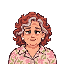 | Teresa Valença | Mãe de Nico (02), fora da empresa | Nome provisório; reserva |
| 02 · `personagem-02` | 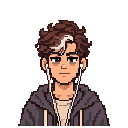 | Nicolas 'Nico' Valença | Amigo antigo do protagonista, fora da empresa | Nome provisório; reserva |
| 03 · `personagem-03` |  | Rafa Nogueira | Colega esportista; Analista de Arquivo e rival profissional | Confirmado e ativo |
| 04 · `personagem-04` | 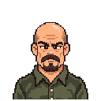 | Silas Braga | Homem misterioso de fora da empresa | Nome provisório; reserva |
| 05 · `personagem-05` |  | Valter Amaral | Homem de fora da empresa | Nome provisório; reserva |
| 06 · `personagem-06` | 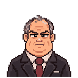 | Arnaldo Severo | Sócio do dono da empresa | Nome provisório; reserva |
| 07 · `personagem-07` |  | Mauro Valença | Colega de trabalho do protagonista; pai de Nico (02) | Nome provisório; reserva |
| 08 · `personagem-08` | 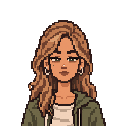 | Jade Moreira | Garota de fora da empresa | Nome provisório; reserva |
| 09 · `personagem-09` | 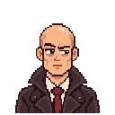 | Raul Vilar | Segundo homem misterioso de fora da empresa | Nome provisório; reserva |
| 10 · `personagem-10` | 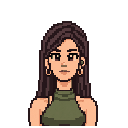 | Cecília Moura | Mulher de fora da empresa | Nome provisório; reserva |
| 11 · `personagem-11` |  | Fábio Nunes | Colega constantemente cansado | Nome provisório; reserva |
| 12 · `personagem-12` |  | Marcelo Bastos | Gerente da empresa; irmão de Caio (19) | Nome provisório; reserva |
| 13 · `personagem-13` | 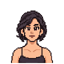 | Nina Alves | Mulher de fora da empresa | Nome provisório; reserva |
| 14 · `personagem-14` | 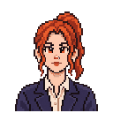 | Íris Monteiro | Amiga antiga do protagonista, trabalha em outra empresa | Nome provisório; reserva |
| 15 · `personagem-15` |  | Bia Torres | Analista de RH | Confirmado e ativo |
| 16 · `personagem-16` |  | Otávio Prado | Analista Financeiro Sênior, aspirante a padeiro | Confirmado e ativo |
| 17 · `personagem-17` | 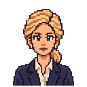 | Patrícia Campos | Mulher de outra empresa; colega de Íris (14) | Nome provisório; reserva |
| 18 · `personagem-18` | 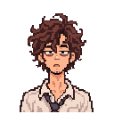 | Breno Lima | Colega do protagonista | Nome provisório; reserva |
| 19 · `personagem-19` |  | Caio Bastos | Irmão do gerente (12), fora da empresa | Nome provisório; reserva |

## Retrato individual aprovado, fora da numeração

| NPC | Imagem | Arquivo | Status |
|---|---|---|---|
| **Lu Reis (`lu`)** |  | `lu-reis.png` | Confirmado e ativo no MSworkN e nas videochamadas |

A Lu é uma personagem **já existente**, amiga do protagonista desde a escola, ilustradora freelancer e tutora do gato Boleto. É a primeira NPC a falar com o jogador, antes do início do expediente (`lu_pre`). Não adicionar esta arte como `personagem-20` nem duplicar sua identidade. A troca é exclusivamente visual e não altera seus diálogos, arcos, progressão, agenda ou vínculos.

## Relações estabelecidas

- **Amizades antigas antes do jogo:** o protagonista já é amigo de **Nico (02)** e **Íris (14)**. **Lu Reis**, já existente no jogo, também é amiga antiga e continua sendo personagem diferente.
- **Colegas e amizades futuras:** **Rafa Nogueira (03)** já trabalha na empresa, mas amizade e confiança com o protagonista devem se construir durante o jogo. O mesmo princípio se aplica aos demais colegas sem amizade declarada.
- **Família Valença:** Teresa (01) é mãe de Nico (02); Mauro (07) é pai de Nico e colega do protagonista. Nomes/sobrenomes dessa família ainda são provisórios.
- **Irmãos Bastos:** Marcelo (12), gerente, e Caio (19), irmão dele. Nomes provisórios.
- **Outra empresa:** Íris (14) é amiga antiga do protagonista e Patrícia (17) trabalha com ela; Patrícia não começa como amiga do protagonista.
- **Homens misteriosos:** Silas (04) e Raul (09) não têm relação entre si confirmada; nada de conspiradores/vilões sem aprovação.

## Uso no jogo

| NPC já implementado | Retrato | Foto de perfil no MSworkN | Videochamada |
|---|---|---|---|
| Duda (`duda`) | Retrato original incorporado em `src/js/shared/52-npc-portraits.js` | Original, 48 px | Original estático de 128 px |
| Rafa (`rafa`) | `personagem-03.png` | Imagem estática, pixelada | Retrato estático, sem animação |
| Bia (`bia`) | `personagem-15.png` | Imagem estática, pixelada | Retrato estático, sem animação |
| Otávio (`otavio`) | `personagem-16.png` | Imagem estática, pixelada | Retrato estático, sem animação |
| Helena (`helena`) | Retrato dedicado ainda não criado | Visual gerado antigo | Busto gerado antigo |
| **Lu (`lu`)** | **`lu-reis.png` (novo visual oficial)** | **PNG estático pixelado** | **Retrato estático de 128 px, sem animação** |

Os quatro retratos aprovados (Rafa, Bia, Otávio e Lu) são carregados pelo mapeamento `src/js/shared/52b-npc-approved.js`, que mantém o código do Duda e todo o elenco existente inalterados. Para chamadas de vídeo com câmera permitida, os três usam imagem estática com a mesma API de reações/fala (sem quadros aprovados de animação); as opções de diálogo, agendas, disponibilidade, relações e condições especiais de chamada não mudam.

Na versão web, o build copia os PNGs para `dist/web/npc-portraits/`; na versão offline, o build incorpora as imagens como data URIs. A renderização usa `image-rendering: pixelated`.

O arquivo `assets/npc/portraits/manifest.json` vincula os três retratos numerados ativos aos IDs reais do motor social, preserva os demais como `reservado` e registra separadamente o retrato oficial da Lu (sem acrescentá-lo à numeração).

## Próximas decisões de história

Nomes, traços de personalidade e relações para todos os retratos estão documentados em [ELENCO-PLANEJADO.md](ELENCO-PLANEJADO.md). Esses rascunhos não ativam contatos nem criam arcos novos. A direção e as regras canônicas continuam em [DIALOGOS-E-LORE.md](DIALOGOS-E-LORE.md).
